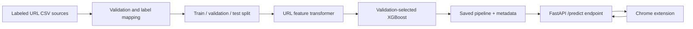

# Architecture and learning plan

## End-to-end flow

The saved object is a complete pipeline, not just a classifier. Packaging the
feature transformer with the model guarantees that training and API inference
use identical logic.

## Components

### Data layer

- Keep the downloaded CSV immutable in `data/raw/`.
- Normalize labels to `1 = phishing` and `0 = legitimate` inside our project.
- Remove exact duplicate URLs and investigate URLs with conflicting labels.
- Split by registered domain when possible, rather than randomly by row. A
  random split can place near-identical URLs from one domain in both training
  and test data, producing an unrealistically optimistic score.

### Feature layer

Start with explainable properties computable from the URL string alone:

- total URL, hostname, path, and query length;
- counts of dots, digits, hyphens, subdomains, and special characters;
- whether the hostname is an IP address;
- suspicious tokens such as `login`, `verify`, or `update`;
- HTTPS scheme (a weak signal, never proof that a site is safe);
- character entropy and encoded-character counts.

Character n-grams are now implemented as a separate TF-IDF + Logistic Regression
candidate. Source tuning also tests protocol-invariant numeric features: it
replaces the scheme with a constant before extraction and removes `uses_https`,
so protocol cannot indirectly change length or entropy. The active model retains
its existing feature behavior. No webpages, DNS, or WHOIS data are fetched.

### Model layer

1. Establish a dummy-classifier baseline.
2. Train logistic regression as a comparison baseline on the same splits.
3. Compare three regularized XGBoost configurations with validation early stopping.
4. Select by validation F1 and tune the threshold with a phishing-recall target.

Because phishing detection is a safety filter, false negatives and false
positives have different costs. We will report precision, recall, F1,
PR-AUC, ROC-AUC, a confusion matrix, and threshold-specific behavior.

### API layer

FastAPI will expose:

- `GET /health` for readiness;
- `POST /predict` with `{ "url": "..." }`;
- a response containing the normalized label, phishing probability, model
  version, and a small set of human-readable reasons.

The API validates inputs and does not retrieve the submitted URL.

### Extension layer

A minimal Chrome Manifest V3 popup reads the active tab URL, calls the API,
and displays a low/medium/high risk state. During local development the API is
`http://127.0.0.1:8000`; a deployed service can be configured later.

The score is advisory. The UI must not claim a URL is guaranteed safe.

## Implemented pipeline

1. Raw-data inspection and tested cleaning.
2. Registered-domain-aware train, validation, and test splitting.
3. Dummy and logistic baselines plus a URL-feature XGBoost pipeline.
4. Validation-only threshold selection and held-out test evaluation.
5. Full-pipeline joblib packaging with JSON metadata.
6. A validated FastAPI prediction endpoint.
7. A local Chrome Manifest V3 popup client.
8. Configurable source-label adapters, multi-source domain splitting, and split
   hashes checked before training. Each experiment gets its own artifacts.
9. Frozen-threshold evaluation on other datasets, with optional domain exclusion.
10. Domain-grouped CV and source-held-out development tuning. A small six-candidate
    search uses shared packaging and validation helpers; it never deploys a winner.
11. A separate offline HTML feature prototype, not a real-data-trained hybrid yet.

Future production hardening would add authentication, rate limiting, telemetry,
drift monitoring, periodic label refreshes, reputation signals, and deployment
configuration.

## Boundaries of version 1

- The detector analyzes URL text; it does not inspect page content.
- It is an additional warning signal, not a replacement for browser or endpoint
  protection.
- Dataset labels may be noisy and age over time. Test results describe the
  held-out dataset, not guaranteed performance on future attacks.

## File-purpose audit — 2026-10-06

The API does **not** need every script to run. Training commands, diagnostic
commands, tests, and research records have different roles. This is a static
import/command-reference audit plus a passing test run, not a claim that we can
prove which manual commands have ever been used.

### Runtime and shared Python code

| File | Purpose | When used |
|---|---|---|
| `api/main.py` | HTTP input validation, health check, prediction endpoint | Running API |
| `api/__init__.py` | Marks API package | API imports |
| `src/phishguard/__init__.py` | Package/version | Package imports, tests |
| `src/phishguard/config.py` | Repository, data, and artifact paths | API and scripts |
| `src/phishguard/prediction.py` | Loads active pipeline and formats advisory results | API |
| `src/phishguard/features.py` | Numeric URL features; compatible with old saved models | Active XGBoost and training |
| `src/phishguard/data.py` | Label adapters, cleaning, shared source deduplication | Preparation, splitting, evaluation, tuning |
| `src/phishguard/domains.py` | Offline registered-domain grouping | Splitting, leakage checks, content prototype |
| `src/phishguard/split.py` | Domain splits and leakage validation | Training and experiments |
| `src/phishguard/modeling.py` | Model builders and classification metrics | Training/evaluation; not a separate app |
| `src/phishguard/text_features.py` | Protocol-free character-model normalization | Character candidate; saved artifacts depend on its import path |
| `src/phishguard/experiments.py` | CV, source tuning, threshold/weight helpers, shared packaging | `benchmark_models.py`, optional hybrid benchmark |
| `src/phishguard/content.py` | Bounded offline HTML aggregates | Optional hybrid prototype; **not active API** |

All shared modules have import references. No shared module was identified as
unreferenced dead code. Small transformer modules also support serialized model
compatibility; deleting them can break previously saved models.

### Commands, not runtime dependencies

| File in `scripts/` | Purpose | Status |
|---|---|---|
| `benchmark_models.py` | Main current research command: `--mode benchmark` or `--mode tune` | Current workflow |
| `evaluate_external.py` | Frozen-model stress tests, guarded `--final-test`, validation-only threshold comparison | Current workflow |
| `prepare_data.py` | Standardizes a new dataset's URLs and label meaning | Needed for new datasets |
| `split_data.py` | Creates isolated domain splits and provenance hashes | Needed when rebuilding datasets |
| `compare_url_models.py` | Local side-by-side candidate scores | Optional manual demonstration |
| `activate_model.py` | Archives/replaces the API model after approval | Deployment step; refuses development candidates |
| `train_model.py` | Reproduces the older validation-F1 training/active-model experiment | Historical/reproduction workflow; not current source tuner |
| `download_data.py` | Obtains original PhiUSIIL data | One-time/reproduction command |
| `download_hf_urls.py` | Downloads two pinned data-only HF URL sources | One-time/reproduction command |
| `inspect_data.py` | Original detailed PhiUSIIL inspection | Manual learning utility; not called by the pipeline |
| `inspect_external_dataset.py` | Simple inspection of `balanced_urls.csv` | Manual utility; overlaps the inspector above |
| `benchmark_hybrid.py` | Same-row comparison with saved HTML | Optional/future, requires a content dataset |
| `inspect_html.py` | Prints aggregate features for a saved HTML fixture | Optional demonstration, not a trained detector |

The two inspectors are not imported by other project code and were not
documented as core commands before this audit. They are callable utilities,
not automatically executed training steps. They can be consolidated into one
configurable inspector; they were **not deleted**, because the external inspector
already has uncommitted edits and both remain part of the learning history.

For today's work, focus on **three shared files** (`features.py`, `modeling.py`,
`experiments.py`) and **two commands** (`benchmark_models.py`, `evaluate_external.py`).
There is no need to open all scripts at once.

### Browser files

| File | Purpose |
|---|---|
| `extension/manifest.json` | Extension identity, permissions, popup entry point |
| `extension/popup.html` | Popup layout |
| `extension/popup.css` | Popup appearance |
| `extension/popup.js` | Reads active-tab URL and calls local API |
| `extension/README.md`, `api/README.md` | Human setup instructions; not executed |

### Tests and documentation

All twelve `tests/test_*.py` files are collected by pytest. They cover data,
features, domains, splits, model fitting, source isolation/experiments, prediction,
API behavior, dataset/download adapters, offline content, and package/path checks.
They are verification code, not unused production code.

| Document | Purpose |
|---|---|
| `README.md` | Main setup and current status |
| `docs/architecture.md` | Architecture and this file-purpose guide |
| `docs/model-card.md` | Active model's measured performance and limitations |
| `docs/model-comparison.md` | New CV/source-tuning experiments, results, commands |
| `docs/xgboost-experiments.md` | Earlier XGBoost experiments and reproduction |
| `docs/external-evaluation.md` | Earlier Kaggle stress-test evidence |
| `docs/huggingface-evaluation.md` | Earlier frozen HF results; those sources now used for development |
| `docs/project-journey.md` | Learning/history record |
| `SECURITY.md` | Safe-testing and issue-reporting policy |
| `notebooks/README.md` | **Inactive placeholder**; no actual notebooks are present |

Documentation is read by people, not imported by the API. Historical reports
should remain identifiable as historical rather than be mistaken for new-model
results. The notebook placeholder can be removed if a notebook workflow is not
wanted; it was left untouched.

### Data, artifacts, and generated clutter

- `artifacts/phishguard_model.joblib` and `artifacts/model_metadata.json` are the
  **only active model pair** read by the default API.
- `artifacts/experiments/` contains inactive candidate models and their reports.
  Tuning saves only the selected XGBoost and the character comparison, not all
  six trial models. A `reference/` split trio is required to exclude tuning-used
  domains correctly during later frozen evaluation.
- `artifacts/archive/` holds rollback copies; it is not read during normal
  prediction. Do not delete it while rollback is still useful.
- `data/raw/` and `data/external/` hold original sources; `data/processed/` holds
  cleaned/split data. These are for research/reproduction, not API prediction.
  Older splits are not used by current tuning but support earlier experiments.
- `examples/hybrid/login_fixture.html` is an inert demonstration only.
- `.pytest_cache/`, `.ruff_cache/`, and `__pycache__/` are regenerable caches.
- `.venv/` is the **working Python environment**, not a disposable experiment.
- `pyproject.toml` declares dependencies/package/test configuration; `.gitignore`
  keeps generated data, artifacts, and caches out of Git.

No source files or datasets were deleted during this audit. No new Python files
were added for source tuning. Duplicate source-cleaning and model-packaging logic
were consolidated in the existing modules, preserving old commands and artifacts.
