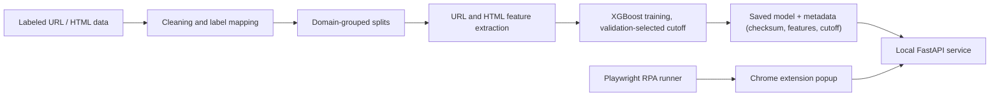

# PhishGuard ML: project overview

Research topic (TalentUD): **Evaluating On-Device Phishing Detection Models on
Real-World Web Pages**.

The research question is whether lightweight models that run on the user's own
device can detect previously unseen phishing pages. The models combine URL
features with static webpage-content features. The aim is to keep false alarms
low, protect privacy and give useful explanations.

This document summarises the whole project as of 24 October 2026. The detailed
reports it draws on are in [`archive/`](archive/); see the index at the end.

## 1. What exists today

| Component | Status |
|---|---|
| URL-only model | Native XGBoost, 21 lexical URL features, trained on PhreshPhish. Served by default. Cutoff `0.4901971220970154`, SHA-256 prefix `9d9ae6a4808b`. |
| URL+HTML model | Native XGBoost, 21 URL and 17 static HTML features (38 total). Cutoff `0.2209`, SHA-256 prefix `41f3e3c9a25b`. Experimental, used only for real-website testing. |
| Local API | FastAPI on `127.0.0.1:8000`. `POST /predict` takes a URL; `POST /predict_html` takes a URL and the page HTML the browser already loaded. It never fetches websites. |
| Chrome extension | Manifest V3 popup. "Check this URL" uses the URL-only model; "Check URL + page content (experimental)" uses the URL+HTML model. |
| RPA test runner | Playwright drives the real extension popup on a fixed website list ([section 7](#7-real-world-testing)). |
| Old joblib model | Kept only for rollback (`PHISHGUARD_MODEL=legacy`). |

Inference runs on-device through the local Python service. Running the model
inside the browser itself (planned ONNX export) is not implemented yet.

When the API loads a model, it checks the model's checksum, feature order and
tree range. A missing or damaged model makes the affected endpoint return HTTP
503; the API never silently falls back to a different model.

## 2. Features

**URL features (21):**
- lengths of the URL, hostname, path and query
- counts of dots, hyphens, underscores and digits, plus the digit ratio
- subdomain and query-parameter counts
- percent-encoding and special-character counts
- whether the host is an IP address, uses HTTPS, contains `@` or has an explicit port
- suspicious-word count
- character entropy, longest-token length and TLD length

They are computed from the URL string alone. `slash_count` was removed after it
caused a shortcut (section 4).

**HTML features (17):**
- forms, password fields and hidden fields
- forms that submit to another domain
- link, script, iframe and image counts, and the share of external links and scripts
- HTML length, title length and title/brand mismatch
- three flags for HTML available, truncated and unparseable

At most the first 1 MB is parsed. The extractor never runs JavaScript or loads
resources.

Gain importance in the URL+HTML model is led by `link_count` (28.5%), then path
length, URL length and query features. HTML features account for 48.7% of the
total gain. These are global model associations, not causes.

## 3. Data

| Source | Use |
|---|---|
| PhiUSIIL (Kaggle) | 235,370 cleaned URLs. Version 1 and mixed-source models. Its labels are inverted relative to this project's convention (`1 = phishing`). |
| `balanced_urls.csv` | 339,356 cleaned URLs. Mixed-source model. Provenance unverified. |
| PhreshPhish (Hugging Face, CC BY 4.0) | Current models: 494,051 paired URL+HTML development pages from the full 36.6 GB download, plus a publisher test set. |
| Kaggle and Hugging Face external sets | Frozen-model stress tests (section 4). Now development evidence only. |

Labels are normalised to `1 = phishing`, `0 = legitimate`. Missing URL schemes
are rejected rather than guessed. Raw datasets are kept locally and are not
published in this repository.

## 4. Experiment history and lessons

**Version 1 (logistic regression, PhiUSIIL).** 94.41% test accuracy on
domain-disjoint splits. A spot check showed `https://www.apple.com/de/` scored
near 100%: legitimate rows were mostly root URLs, so `slash_count` became a
shortcut. Lesson: a strong offline score is not real-world reliability.

**Version 2 (XGBoost, 21 features, PhiUSIIL + balanced source).** 93.19%
accuracy and a 6.37% false-positive rate (FPR) on a mixed holdout. The FPR was
10.84% on the balanced source.

**Frozen external stress tests** (no retraining):

| Dataset | Accuracy | False-positive rate |
|---|---:|---:|
| Kaggle "Phishing Site URLs" (HTTPS assumption) | 67.51% | 29.14% |
| Hugging Face PhishNChips | 44.42% | 88.22% |
| Hugging Face ealvaradob, complete URLs | 71.50% | 34.36% |

The model did not generalise across sources.

**Dataset audit (8 Oct).** It found strong collection shortcuts:
- all PhiUSIIL legitimate URLs are HTTPS `www.` root URLs
- protocol alone scores 98.6% on one uploaded set
- Blogspot and long hostnames drive many false positives
- 4 training rows have identical features but opposite labels

**Grouped CV and source-held-out tuning (6–8 Oct).** A character TF-IDF model
and six XGBoost variants were compared. The protocol-invariant variant had the
lowest worst-source FPR (4.36%), but no variant was good enough to deploy.

**PhreshPhish URL vs URL+HTML (11 Oct).** Same rows for all variants,
validation-selected cutoffs, purged publisher test (84,746 pages):

| Model | Features | Accuracy | Recall | FPR |
|---|---:|---:|---:|---:|
| URL-only | 21 | 84.98% | 82.72% | 10.62% |
| HTML-only | 17 | 84.43% | 90.97% | 28.31% |
| URL+HTML | 38 | 88.75% | 92.52% | 18.58% |

With cutoffs chosen for about 1% validation FPR, URL+HTML reached 72.37% recall
at 1.80% test FPR, against 61.35% at 1.70% for URL-only.

## 5. Evaluation of the current models (16–19 Oct)

### Leakage audit

- **Records:** all 578,797 records across the four splits match their original
  checksums. The URL features re-extract exactly.
- **Overlap:** no exact URL, registered domain or identical page content appears
  in more than one split or cross-validation role.
- **Label conflicts:** 9 identical-content hashes carry both labels (66
  records). Raw HTML review showed they are mostly generic pages: unavailable
  Shopify stores, Apache default pages and geo-blocked pages. This is a risk
  that the captured content doesn't match the URL's label. No records were
  relabelled.
- **Not ruled out:** near-duplicate templates and overlap in time. Training
  dates (2024-07 to 2025-09) overlap the internal test set.

### Five-fold grouped cross-validation

- **Data:** 454,185 development records in 154,074 domain/identical-content
  groups. Each group stays in one fold.
- **Separate validation:** a grouped inner validation set chose early stopping
  and the cutoff. The test sets were not used.
- **Pairing:** both models used identical fold assignments.

| Model and cutoff policy | Accuracy | Precision | Recall | FPR |
|---|---:|---:|---:|---:|
| URL-only, F1 policy | 90.93% | 90.09% | 89.95% | 8.26% |
| URL+HTML, F1 policy | 92.59% | 95.01% | 88.35% | 3.87% |
| URL-only, ≤1% inner FPR | 86.68% | 98.26% | 71.98% | 1.06% |
| URL+HTML, ≤1% inner FPR | 90.14% | 98.45% | 79.57% | 1.04% |

- **Ranking quality:** URL-only pooled ROC-AUC 96.87%. URL+HTML fold-mean
  ROC-AUC 98.60%.
- **Paired bootstrap** (1,000 draws, whole groups resampled): URL+HTML lowered
  the F1-policy FPR by 4.38 points (95% interval 3.76 to 5.03). The recall
  differences were not conclusive; their intervals include zero.
- **Instability:** the URL-only FPR ranged from 4.25% to 16.71% across folds.
  In fold 5, one linked group of 3,340 domains made up 27.9% of the inner
  validation data and moved the cutoff.

These are development results, not real-world accuracy. The hyperparameters
were chosen earlier on the same collection.

## 6. On-device measurements

- **Local URL-only service** (Mac ARM64 CPU): median 0.23 ms per URL (p95
  0.29 ms). The model loads in 73 ms and is 2.4 MB.
- **Extension content check:** median 72 ms from click to result, including
  page capture and inference, measured in the RPA smoke test.

Browser-only inference, memory and energy have not been measured yet.

## 7. Real-world testing

**Manual UI pilot (16 Oct).** Native UI automation opened the popup on 4 public
pages. All popups matched the API. `docs.python.org` was a false positive
(70.3/100).

**RPA runner (23 Oct).**
- **What it does:** `scripts/rpa_extension_check.py` starts Chromium with a
  fresh profile and the unpacked extension. It opens the real popup through the
  Chrome DevTools command `Extensions.triggerAction`, which counts as a user
  click, then clicks the content button.
- **What it records:**
  - display/API agreement
  - URL-only vs URL+HTML decisions
  - raw-HTML vs rendered-DOM scores
  - latency, errors and screenshots
- **Safety:** simulated phishing-like cases use reserved test hosts served from
  local fixtures. No live phishing page is ever visited.

**Website list.** [`examples/rpa/sites.csv`](../examples/rpa/sites.csv) holds 197
real legitimate pages across banks, government, education, news, shopping,
email and software. It excludes 952,870 domains seen anywhere in the project.
Each site's official status was verified through Wikidata. The list is frozen
before scoring.

**Early warning from smoke tests.**
- All 26 test cases ran, and every displayed result matched the API.
- The URL+HTML model flagged mozilla.org's homepage HIGH, and the URL-only
  model did not.
- All 5 benign control fixtures (plain article pages) were also flagged HIGH.

The URL+HTML model and its 0.2209 cutoff may flag many small or unusual
legitimate pages. The full run on the 197 sites will measure this.

**Fresh URL-only benchmark.**
- 100 OpenPhish candidates and 100 Tranco candidates, excluding all previously
  seen domains.
- The model, cutoff and code are frozen.
- Scoring is blocked until every label has been reviewed independently. A
  missing blocklist match does not count as "legitimate".
- No accuracy result exists yet.

## 8. Limitations

- Model scores are not calibrated probabilities. The popup's "reasons" come
  from URL rules and don't explain HTML-based decisions.
- Development data has overlapping dates and shared collection sources, so no
  result here proves real-world reliability.
- The extension sends the DOM after JavaScript has run, while training used
  crawler snapshots. The runner measures this difference.
- Several earlier datasets have unverified provenance, and labels age over time.

## 9. Next steps

1. Run the RPA test on all 197 sites once. Report the false-positive rate per
   category with Wilson intervals, and how often the two models disagree.
2. Finish the independent label review and score the fresh URL-only benchmark
   once.
3. Compare the original logistic baseline on the same cohort.
4. Try more stable cutoff policies, e.g. balanced across groups or a fixed FPR
   budget. These must be declared before running.
5. Export the models for in-browser inference and test that the browser
   produces the same features and scores as Python. Measure latency, memory and
   privacy behaviour.

## 10. Detailed reports (archive)

| Report | Content |
|---|---|
| [project-journey.md](archive/project-journey.md) | Version 1 build and the slash-count lesson |
| [architecture.md](archive/architecture.md) | Components and file-purpose audit |
| [model-card.md](archive/model-card.md) | Model details and limitations |
| [xgboost-experiments.md](archive/xgboost-experiments.md) | Version 2 XGBoost and mixed-source data |
| [external-evaluation.md](archive/external-evaluation.md) | Kaggle stress tests |
| [huggingface-evaluation.md](archive/huggingface-evaluation.md) | Hugging Face stress tests |
| [dataset-audit-report.md](archive/dataset-audit-report.md) | Dataset shortcuts and label audit |
| [model-comparison.md](archive/model-comparison.md) | Grouped CV, character model and source tuning |
| [local-check-2026-10-09.md](archive/local-check-2026-10-09.md) | Windows verification and dataset candidates |
| [native-local-training.md](archive/native-local-training.md) | Native PhreshPhish URL training |
| [native-html-training.md](archive/native-html-training.md) | HTML feature design |
| [html-training-results-2026-10-11.md](archive/html-training-results-2026-10-11.md) | URL vs URL+HTML results |
| [mac-pull-and-models.md](archive/mac-pull-and-models.md) | Moving models to a Mac |
| [talentud-evaluation-plan.md](archive/talentud-evaluation-plan.md) | Evaluation protocol and on-device plan |
| [professor-evaluation-followup.md](archive/professor-evaluation-followup.md) | Cross-validation, leakage and uncertainty in full |
| [frozen-url-benchmark.md](archive/frozen-url-benchmark.md) | Fresh benchmark and label-review protocol |
| [rpa-real-world-testing.md](archive/rpa-real-world-testing.md) | RPA setup, safety and smoke tests |
